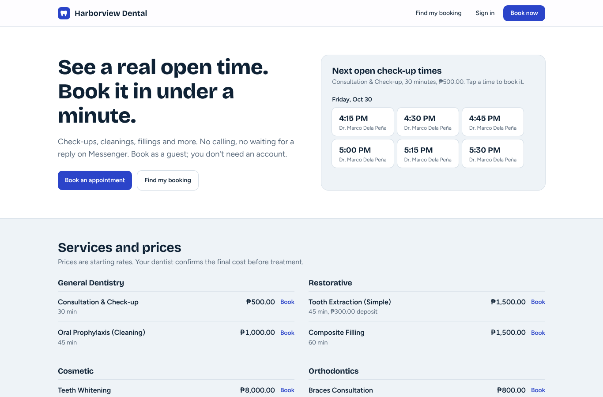
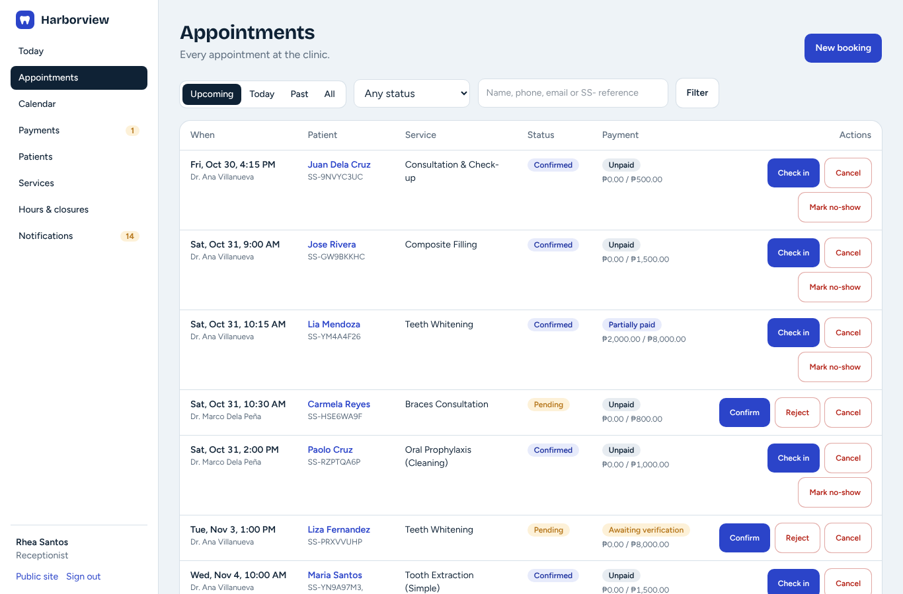
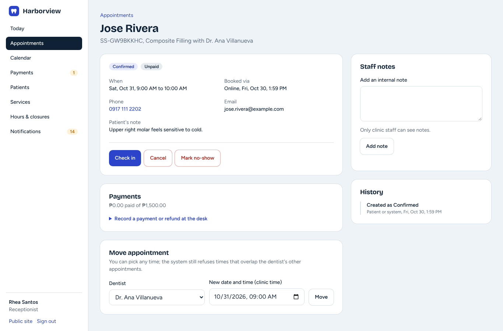
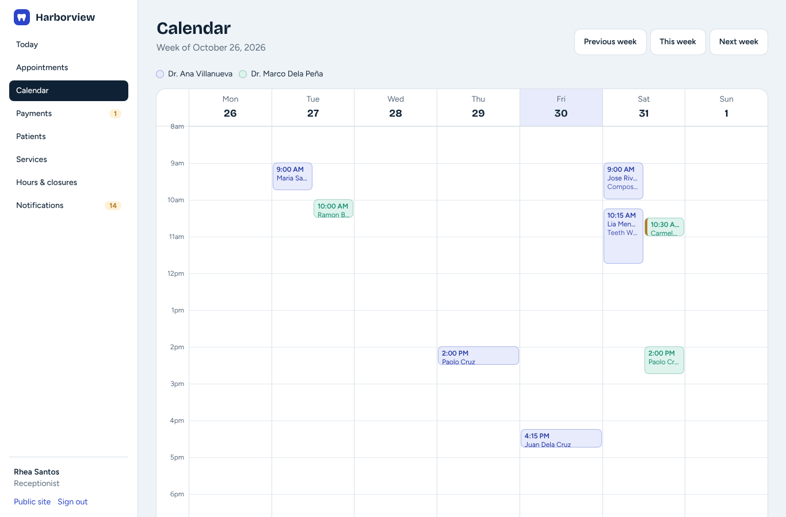
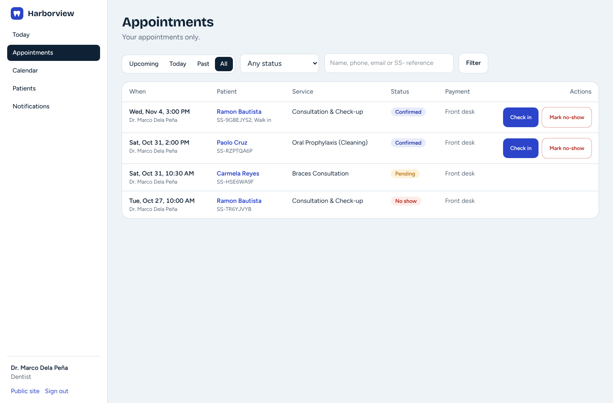
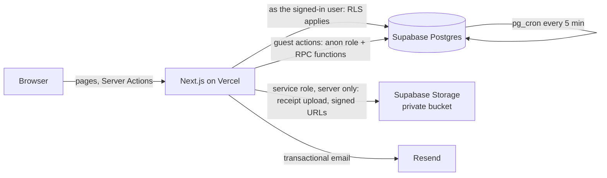

# SmileSlot: online booking for a small dental clinic

**Live demo:** _add your Vercel URL here_ · **Stack:** Next.js 16 (App Router), TypeScript, Supabase (Postgres, Auth, Storage, Row Level Security), Tailwind CSS 4

SmileSlot replaces the usual small-clinic setup of a paper appointment book, a Facebook Messenger inbox and GCash screenshots scattered across a receptionist's phone. Patients see real open times and book in under a minute, as guests or with an account. The front desk confirms bookings, verifies GCash, Maya and bank payments, and handles walk-ins from one dashboard. Each dentist sees only their own patients.

The demo runs a fictional clinic, **Harborview Dental Clinic**.



## Try it

| Role | Email | What to try |
|---|---|---|
| Guest | (no login) | Book from the homepage time buttons, then use **Find my booking** with the reference and email |
| Receptionist | `frontdesk@demo.smileslot.app` | Verify a GCash receipt, add a walk-in, move an appointment |
| Dentist | `dr.ana@demo.smileslot.app` | Check a patient in; try to open Dr. Marco's appointments (you can't) |
| Owner | `owner@demo.smileslot.app` | Change booking rules, manage staff roles, read the audit log |
| Patient | `patient@demo.smileslot.app` | My bookings |

The demo password is shared privately on request.

## Who can see which records

This is enforced inside Postgres with Row Level Security, not just by hiding buttons. The app talks to the database as the signed-in user, so even a hand-crafted API request gets the same answer.

| | Guest | Patient | Dentist | Receptionist | Owner |
|---|---|---|---|---|---|
| Services, prices, dentists | ✅ | ✅ | ✅ | ✅ | ✅ |
| Open time slots (times only, no names) | ✅ | ✅ | ✅ | ✅ | ✅ |
| Appointments | Own, via reference + email | Own | **Only their own patients** | All | All |
| Patient records | ✗ | Own | Only their own patients | All | All |
| Payments and receipts | Own status only | Own | ✗ | All, can verify | All, can verify |
| Internal staff notes | ✗ | ✗ | On their appointments | All | All |
| Clinic settings, staff roles | ✗ | ✗ | ✗ | ✗ | ✅ |
| Audit log | ✗ | ✗ | ✗ | ✗ | Read-only |

Details and the reasoning behind every policy are in [docs/SECURITY.md](docs/SECURITY.md).

## What it does

**For patients**
- Live availability calculated from each dentist's working hours, breaks, holidays, time off, service length, cleanup time between patients, and existing bookings
- Guest booking with no account needed, and a reference number like `SS-7K4MQ2XP`
- Track, pay for and cancel a booking with reference + email (online cancellation closes 24 hours before)
- Deposits: the time is held while the patient pays by GCash, Maya or bank transfer and uploads the receipt. Unpaid holds expire automatically.
- Optional account: earlier guest bookings appear once the email address is confirmed

**For the clinic**
- Today view, filterable appointment list, weekly calendar with one lane per dentist
- Status flow: Pending → Confirmed → Checked in → In progress → Completed, plus Cancelled, Rejected, No-show and Expired. Invalid jumps are refused by the database.
- Payment verification queue with short-lived links to private receipt files. A screenshot never counts as paid until a staff member verifies it.
- Walk-in and phone bookings, rescheduling, internal notes, full status history
- Services, prices, deposits and which dentist offers what; working hours, breaks, closures, time off
- Owner settings (booking rules, policies, payment instructions), staff roles, and an audit log written by database triggers
- Email (Resend) and in-app notifications

| Front desk: today | Appointment detail |
|---|---|
|  |  |
| **Weekly calendar** | **Dentist's view: only their patients** |
|  |  |

## How double booking is prevented

Two people clicking **Book** on the same slot at the same moment is the classic booking bug. Checking availability in application code first and then inserting has a race window. SmileSlot closes it in the database itself:

```sql
constraint reservations_no_overlap exclude using gist (
  resource_id with =,
  tstzrange(starts_at, blocked_until, '[)') with &&
) where (status in ('pending', 'confirmed', 'checked_in', 'in_progress', 'completed'))
```

Postgres refuses any second active booking for the same dentist whose time range overlaps, including the cleanup buffer. The test suite fires 10 parallel bookings at one slot: exactly 1 succeeds and 9 are refused.

## Architecture



- **Server Components + Server Actions.** No custom REST API to secure separately. Every action re-validates input with Zod.
- **Guests never write to tables directly.** They call `SECURITY DEFINER` functions (`book_appointment`, `get_booking`, `cancel_booking`, `submit_payment`) that validate everything and return only safe fields.
- **The service-role key** is used in exactly two places: uploading a guest's receipt after the reference + email are verified, and creating 5-minute signed URLs for staff. The `server-only` import makes the build fail if it ever reaches the browser.
- **Database types are generated** from the schema with Supabase's type generator, so queries are type-checked end to end.

Database design and ERD: [docs/DATABASE.md](docs/DATABASE.md).

## Tests

| Suite | What it proves | Run |
|---|---|---|
| Database (76 checks) | Every role tries to read and change what it shouldn't: RLS, column guards, status rules, payment rules, the audit log, expiry, email-confirmation linking. Includes the 10-way race test. | `npm run test:db` |
| Unit (20) | Time-zone math, validation, redirect safety, and that the UI's status buttons match the database trigger's rules | `npm test` |
| End-to-end (37) | A browser walks through guest booking, receipt upload, verification, walk-in, double-booking refusal and every role's access, against real Supabase Auth and PostgREST | `python tests/e2e/smoke.py` |

CI runs typecheck, lint, unit tests, build and the database suite on every push.

## Run it yourself

Step-by-step setup (Supabase project, migrations, Vercel, email): [docs/DEPLOYMENT.md](docs/DEPLOYMENT.md).

```bash
cp .env.example .env.local   # fill in your Supabase keys
npm install
npm run dev
```

## Built with AI coding agents

This project was built with Claude as the coding agent. I set the scope, made the design decisions, and reviewed and tested the changes. [docs/AI_REVIEW_LOG.md](docs/AI_REVIEW_LOG.md) lists real problems that came up during the build, how they were caught, and the test that now guards each one.

## Roadmap

- Reports with PDF/Excel export (bookings, revenue, no-shows, daily collections)
- PayMongo online payments (GCash, Maya, cards) confirmed by signed webhooks
- Waitlist, recurring and group bookings, promo codes
- Drag-and-drop rescheduling on the calendar
- Patient reviews, SMS reminders
- Rate limiting and CAPTCHA on public forms

---

Built by **Angelou Fiel** · Pagadian City, Philippines · angeloufiel24@gmail.com
