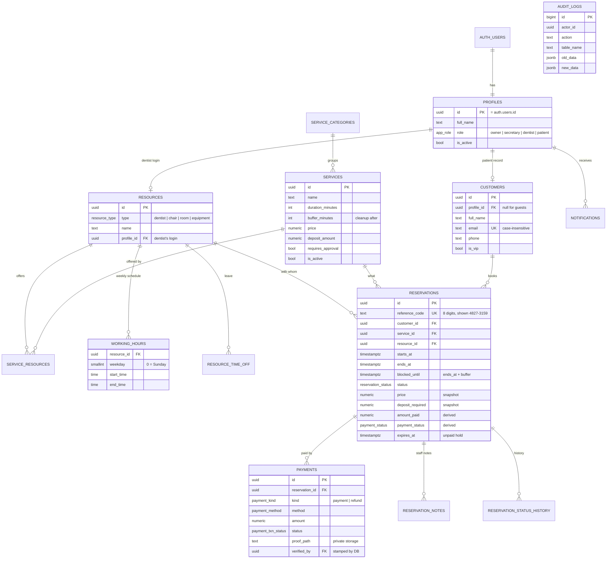
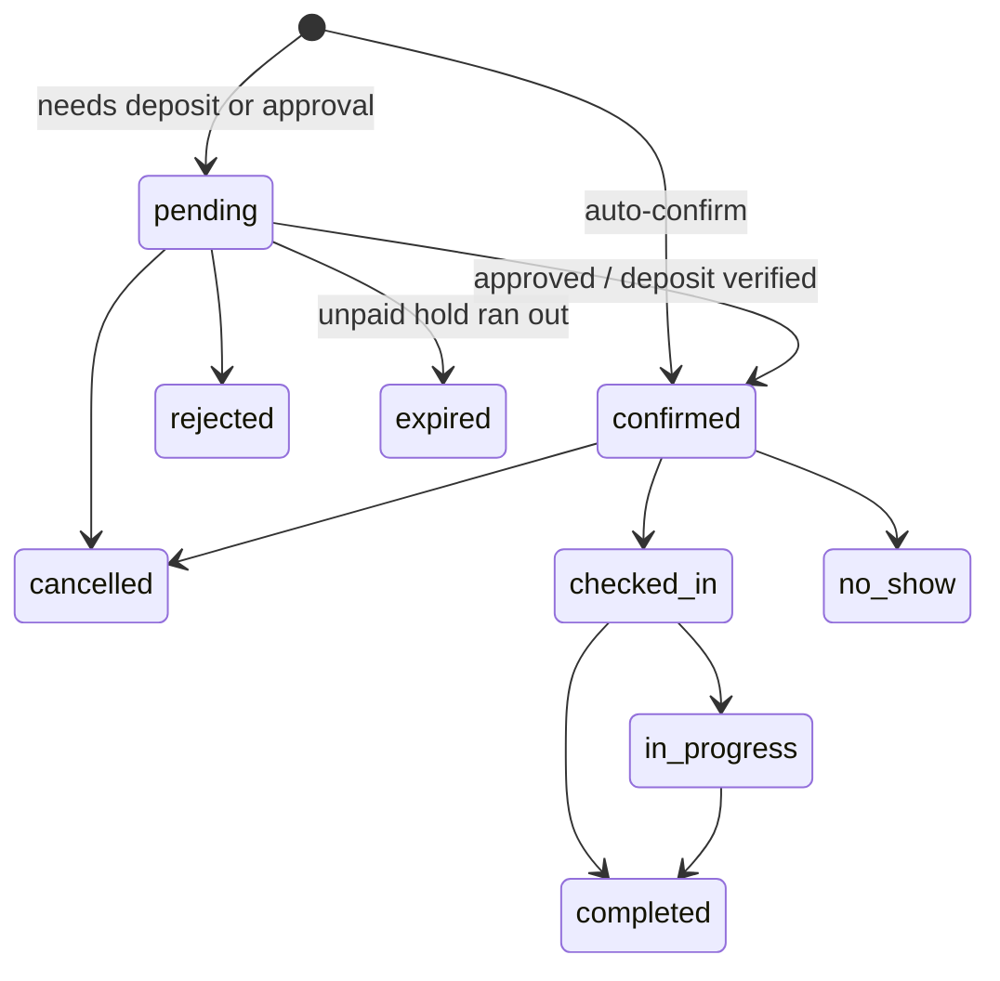

# Database design

All schema lives in `supabase/migrations/`, applied in order:

| File | Contents |
|---|---|
| `…100_schema.sql` | Enums and tables |
| `…200_triggers_and_helpers.sql` | Role helper functions, column guards, status rules, payment rules, audit log, notifications |
| `…300_booking_engine.sql` | Availability, booking, tracking, cancellation and payment functions; expiry job |
| `…400_rls.sql` | Grants and Row Level Security policies |
| `…500_storage.sql` | Private bucket for payment receipts and its policies |

## Entity relationship diagram



(`CLINIC_SETTINGS` is a single-row table and `CLINIC_CLOSURES` is a list of dates; neither has relationships.)

## Design decisions

**Normalised to 3NF, with deliberate snapshots.** A reservation copies the price, deposit and contact details at booking time. If the clinic raises a price next month, last month's bookings and revenue stay correct. That's intentional denormalisation of history, not duplication of live data.

**`resources` instead of a `dentists` table.** A dentist is one kind of resource (others: chair, room, equipment). The availability engine and the double-booking constraint work on any resource, so adding chairs or rooms later doesn't need a redesign.

**Breaks are gaps, not rows.** Monday 09:00–12:00 and 13:00–17:00 are two `working_hours` rows; the lunch break is simply the time between them.

**Money is `numeric(10,2)`, time is `timestamptz`.** No floating-point money. Times are stored in UTC and shown in the clinic's time zone (Asia/Manila, configurable).

**Payments are a ledger.** Each payment or refund is its own row and is never edited after review. A reservation's `amount_paid` and `payment_status` are recalculated from that ledger by a trigger, so they can't drift.

**Data minimisation.** Booking and contact details only. No diagnoses, treatment records or medical history are stored, which keeps the privacy risk (Philippine Data Privacy Act; HIPAA for US clinics) much smaller.

## How availability is calculated

`get_available_slots(service, date, dentist?)` offers a start time only if **all** of these hold:

1. The dentist offers the service and is active
2. The whole appointment fits inside one of the dentist's working-hour blocks that weekday
3. The clinic isn't closed that day, and the dentist has no time off overlapping it
4. No active booking overlaps `[start, start + duration + cleanup buffer)`
5. It's at least the minimum notice from now and within the maximum advance window

Pending bookings whose deposit hold has expired don't block a slot, even before the expiry job has run.

`book_appointment()` re-checks that the requested time is one the engine would offer, then inserts. If another request won the slot a moment earlier, the exclusion constraint rejects the insert and the patient sees "That time was just taken."

## Guest and account records

`customers.email` is unique only among guest records (`profile_id is null`). An account always has its own record, so typing someone's email as a guest never adds a booking to their account, and signing up never adopts someone's guest bookings. A patient adds an old guest booking with `claim_booking(booking number)`.

## Booking status flow



Any other change is refused by the `reservation_before_write` trigger. A unit test checks that the dashboard's buttons match these rules exactly.

## Regenerating TypeScript types

After changing the schema:

```bash
npx supabase gen types typescript --linked > src/lib/supabase/database.types.ts
```
